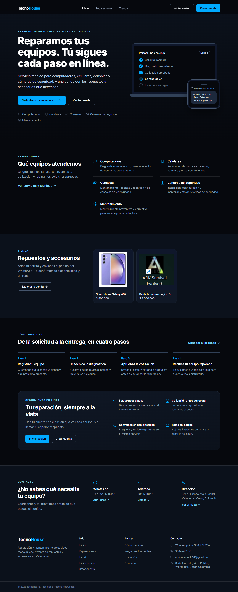
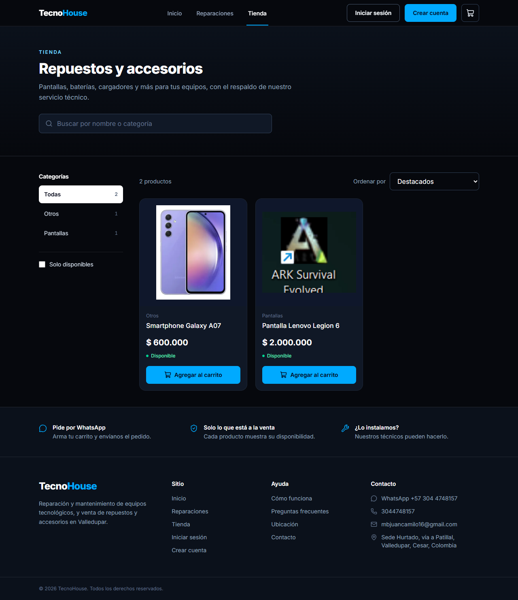
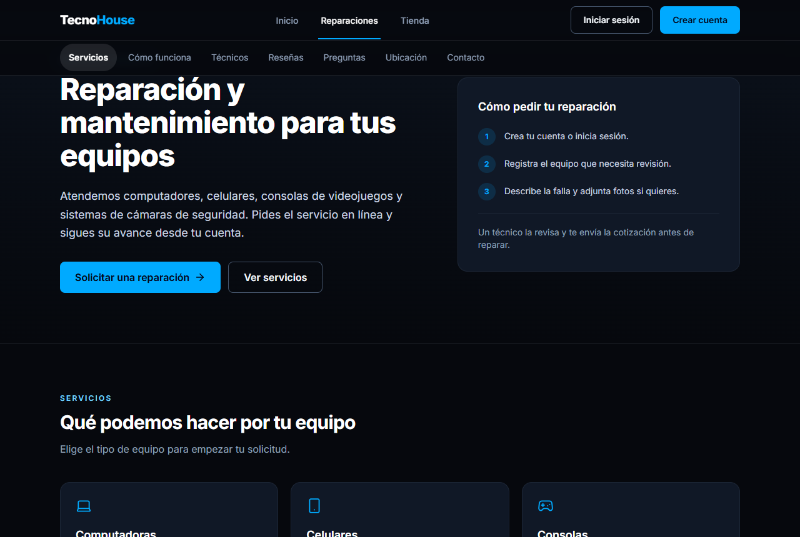
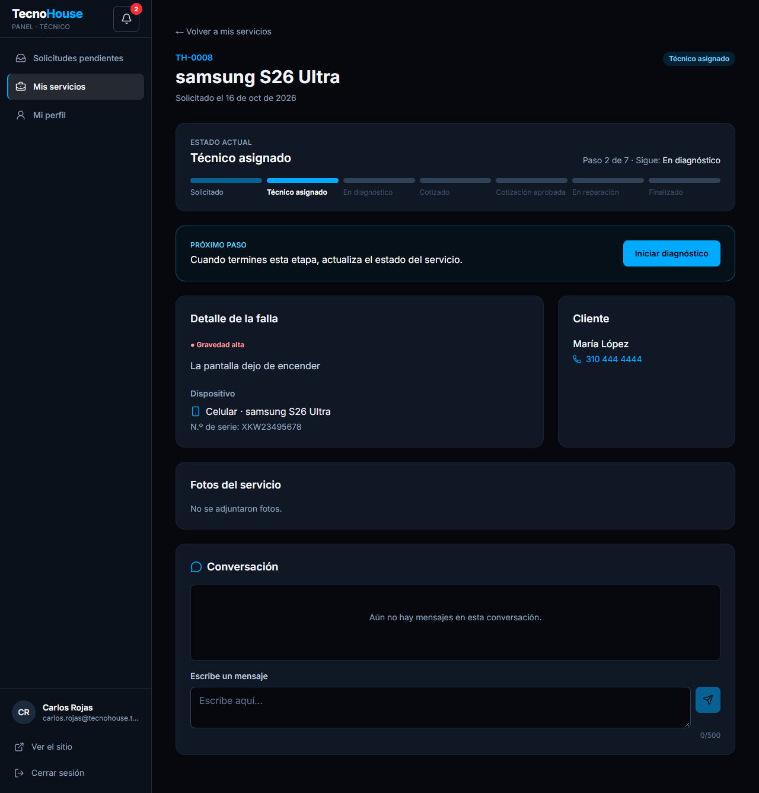
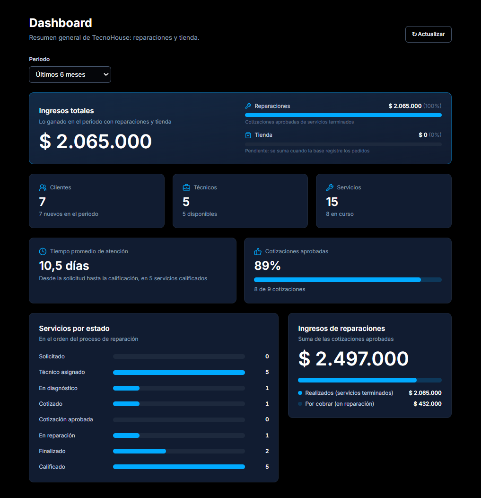

# TecnoHouse

TecnoHouse es una aplicación web para un negocio de reparación y mantenimiento de equipos tecnológicos ubicado en Valledupar, Cesar. Reúne en un solo sitio el servicio técnico y una tienda de productos y repuestos.

El proyecto se desarrolló como trabajo de la asignatura Proyecto de Web, en quinto semestre.

<p align="center">
  
</p>

## El problema

En un taller pequeño, las solicitudes llegan por llamadas o mensajes, el estado de cada equipo se consulta preguntando al técnico y las cotizaciones se pierden entre conversaciones. El cliente no sabe en qué va su reparación y el negocio no tiene datos para saber cuánto trabajo atiende, cuánto gana ni qué técnicos rinden mejor.

TecnoHouse ordena ese proceso:

- El **cliente** registra sus equipos, pide una reparación con fotos, aprueba o rechaza la cotización y sigue cada paso en línea.
- El **técnico** recibe las solicitudes, diagnostica, cotiza y avanza el servicio hasta terminarlo.
- El **administrador** supervisa los servicios, gestiona técnicos y clientes, administra la tienda y consulta los indicadores del negocio.

## Servicios que ofrece el negocio

- Computadoras y laptops: diagnóstico, reparación y mantenimiento.
- Celulares: pantallas, baterías, software y otros componentes.
- Consolas de videojuegos: mantenimiento, limpieza y reparación.
- Cámaras de seguridad: instalación, configuración y mantenimiento.
- Mantenimiento preventivo y correctivo de equipos.

## Cómo avanza una reparación

Cada solicitud recorre estos estados. El cliente los ve en una barra de progreso y recibe un aviso con cada cambio.

| Estado | Quién lo produce |
|---|---|
| Solicitado | El cliente crea la solicitud con el equipo, la categoría del problema, la gravedad y fotos. |
| Técnico asignado | Un técnico toma la solicitud o el administrador la asigna. |
| En diagnóstico | El técnico revisa el equipo. |
| Cotizado | El técnico registra el diagnóstico y los ítems con su precio. |
| Cotización aprobada | El cliente acepta la cotización. Si la rechaza, el servicio vuelve a diagnóstico. |
| En reparación | El técnico trabaja en el equipo. |
| Finalizado | El técnico marca el trabajo como terminado. |
| Calificado | El cliente puntúa el servicio de 1 a 5 y puede dejar un comentario. |

Durante todo el proceso, cliente y técnico pueden escribirse en la conversación del servicio. La cotización también se puede descargar en PDF.

## Capturas

**Tienda**: catálogo con categorías, buscador y carrito.



**Reparaciones**: servicios que ofrece el negocio.



**Panel del técnico**: detalle de un servicio con su progreso, el próximo paso, la falla reportada y la conversación con el cliente.



**Panel del administrador**: dashboard con ingresos, clientes, técnicos, servicios por estado y tasa de cotizaciones aprobadas.

<p align="center">
  
</p>

## Funcionalidades

### Sitio público

| Ruta | Contenido |
|---|---|
| `/` | Portada que separa la tienda de las reparaciones, con vista previa de productos y servicios. |
| `/reparaciones` | Servicios, cómo funciona, técnicos, reseñas de clientes, preguntas frecuentes, contacto y ubicación. |
| `/tienda` | Catálogo con categorías, buscador, filtro de disponibles y orden por precio, nombre o fecha. |
| `/tienda/:id` | Detalle del producto, productos relacionados y consulta por WhatsApp. |

La tienda tiene un carrito lateral que se guarda en el navegador y envía el pedido por WhatsApp con la lista de productos y el total. No permite pedir más unidades que el stock disponible.

### Cuentas

- Registro con confirmación por correo y opción de reenviar el correo.
- Inicio de sesión que lleva a cada usuario al panel de su rol.
- Recuperación de contraseña por correo.

### Panel del cliente (`/cliente`)

- Resumen de sus solicitudes activas.
- Registro de dispositivos: computadores, celulares y consolas.
- Solicitudes de reparación con fotos, seguimiento del estado, conversación con el técnico, cotización y calificación.
- Perfil.

### Panel del técnico (`/tecnico`)

- Solicitudes pendientes que puede tomar.
- Servicios asignados con diagnóstico, cotización y avance de estado.
- Conversación con el cliente.
- Perfil con su disponibilidad y su calificación.

### Panel del administrador (`/admin`)

- **Dashboard**: servicios por estado, ingresos de reparaciones y de la tienda, clientes nuevos, técnicos disponibles e inventario, con filtro por periodo.
- **Servicios**: listado con filtros, búsqueda y paginación, detalle, reasignación de técnico y exportación a CSV.
- **Técnicos**: creación de cuentas, edición, disponibilidad y activación o desactivación.
- **Clientes**: listado y detalle con sus dispositivos y servicios.
- **Tienda**: productos con imagen, precio, categoría y stock, ajuste rápido de stock y aviso de productos por reponer.
- **Pedidos**: pedidos de la tienda por estado.
- **Estadísticas**: tendencias mensuales, problemas frecuentes, servicios por tipo de dispositivo y técnicos mejor calificados.

Todos los paneles reciben avisos en tiempo real en el menú de notificaciones.

## Tecnologías

| Parte | Herramienta |
|---|---|
| Interfaz | React 19 y React Router 7 |
| Estilos | Tailwind CSS 4 |
| Íconos | lucide-react |
| Compilación | Vite |
| Backend | ASP.NET Core y Supabase: API, autenticación, PostgreSQL, almacenamiento y Realtime |
| Revisión de código | oxlint |

## Arquitectura

La aplicación es una SPA. Supabase Auth administra las sesiones y la API ASP.NET Core atiende operaciones de dispositivos, servicios y perfiles con el JWT de Supabase. Las políticas RLS de PostgreSQL siguen controlando el acceso. Algunos módulos, como la tienda, todavía consultan Supabase directamente. Las vistas públicas (`tecnicos_publicos`, `resenas_publicas` y `productos_activos`) exponen solo los campos que el sitio necesita mostrar.

```
src/
├── api/                Consultas a Supabase y a la API, agrupadas por tema
├── componentes/        Piezas compartidas (avisos, pie de página, ruta protegida...)
│   ├── autenticacion/  Diseño y barra de las páginas de acceso
│   ├── reparaciones/   Secciones de la página de reparaciones
│   ├── tienda/         Encabezado, tarjetas y carrito de la tienda
│   └── panel/          Piezas comunes de los tres paneles
│       ├── cliente/    Solo del panel del cliente
│       ├── tecnico/    Solo del panel del técnico
│       └── admin/      Solo del panel del administrador
├── contexto/           Sesión, tienda, avisos y confirmaciones compartidos por la app
├── datos/              Datos fijos: servicios, estados, menús, categorías y contacto
├── hooks/              Lógica reutilizable de las páginas
├── paginas/            Portada, Reparaciones y página 404
│   ├── autenticacion/  Iniciar sesión, registro y contraseñas
│   ├── tienda/         Catálogo y detalle de producto
│   ├── cliente/        Panel del cliente (/cliente)
│   ├── tecnico/        Panel del técnico (/tecnico)
│   └── admin/          Panel del administrador (/admin)
├── utilidades/         Filtros, formatos, reportes, CSV, PDF, inventario y WhatsApp
└── Aplicacion.jsx      Rutas de la aplicación
supabase/               Scripts SQL de tablas, vistas, funciones y políticas
backend/                API ASP.NET Core y configuración local
docs/                   Guía de cambios, informes de revisión y capturas
```

## Cómo ejecutarlo

Requisitos: Node.js 20.19 o superior y un proyecto de Supabase.

1. Instala las dependencias con `npm install`.
2. Crea un archivo `.env` en la raíz del proyecto. En el Dashboard de Supabase, abre tu proyecto y pulsa **Connect** para copiar la URL y la clave pública. También puedes consultar las claves en **Settings → API Keys**:
   ```
   VITE_SUPABASE_URL=https://tu-proyecto.supabase.co
   VITE_SUPABASE_ANON_KEY=tu-clave-publica
   VITE_TECNOHOUSE_API_URL=http://localhost:5100
   ```
   Usa solo la clave **pública** (`anon` o `sb_publishable_...`). La clave secreta (`service_role` o `sb_secret_...`) nunca va en el navegador ni en el repositorio.
3. Ejecuta `npm run dev` y abre la dirección que muestra la terminal. Si cambias el `.env`, reinicia el servidor.

| Comando | Uso |
|---|---|
| `npm run dev` | Servidor de desarrollo |
| `npm run build` | Compila la aplicación en `dist/` |
| `npm run preview` | Sirve la versión compilada |
| `npm run lint` | Revisa el código con oxlint |

## Configuración de Supabase

Se hace una sola vez por proyecto.

1. **URLs de los correos**: en **Authentication → URL Configuration**, pon en *Site URL* la dirección de la app (ej. `http://localhost:5173`) y agrega en *Redirect URLs* `http://localhost:5173/**` (y la dirección pública cuando el sitio esté publicado). Sin esto, los enlaces de confirmación y de recuperación de contraseña no vuelven a la aplicación.
2. **Scripts SQL**: ejecútalos en el **SQL Editor** en este orden. Todos se pueden ejecutar más de una vez sin perder datos.

| Script | Qué hace |
|---|---|
| `supabase/seguridad_roles.sql` | Impide que un usuario se cambie el rol a sí mismo (por ejemplo, a `admin`). |
| `supabase/vista_resenas.sql` | Publica solo el nombre de pila, puntuación, comentario y fecha de las calificaciones que tienen comentario. |
| `supabase/gravedad_categoria.sql` | Crea las columnas de gravedad y categoría, migra los datos históricos y limpia el prefijo de gravedad de las descripciones. |
| `supabase/fotos_servicio.sql` | Crea el bucket privado, la tabla y las políticas de acceso de las fotos de cada servicio. |
| `supabase/mensajes_servicio.sql` | Crea la conversación de cada servicio entre cliente y técnico, lista para Realtime. |
| `supabase/notificaciones.sql` | Crea los avisos privados de cada usuario. Requiere los dos scripts anteriores. |
| `supabase/crear_tecnico.sql` | Permite que el administrador cree técnicos desde la aplicación. |
| `supabase/catalogo.sql` | Crea la tabla de productos, la vista pública `productos_activos` y el bucket de imágenes de la tienda. |
| `supabase/datos_prueba.sql` | Opcional, solo para desarrollo. Crea un admin, tres técnicos, dos clientes y servicios en distintos estados. Los correos y la contraseña están al inicio del archivo. |

Los scripts de fotos, técnicos y catálogo usan la función `public.rol_actual()`, que ya debe existir en la base.

## Datos

- **API ASP.NET**: abre `backend/TecnoHouse.Api.sln` en Visual Studio y configura sus secretos locales según `backend/README.md`. La API usa el JWT de Supabase y RLS para autorizar las solicitudes.
- **Cuentas**: Supabase Auth. Hay que confirmar el correo antes de iniciar sesión.
- **Perfiles y roles**: tabla `perfiles` (`cliente`, `tecnico` o `admin`). Un trigger crea el perfil con rol `cliente` al registrarse; los técnicos los crea el administrador desde la aplicación y el rol `admin` se asigna desde la base de datos.
- **Dispositivos**: tabla `dispositivos`.
- **Servicios**: tabla `servicios`, con sus cotizaciones, fotos (`fotos_servicio`), mensajes (`mensajes_servicio`) y avisos (`notificaciones`).
- **Productos**: tabla `productos`. La tienda lee la vista pública `productos_activos`.
- **Contacto público**: completa `src/datos/contacto.js` con los datos verificados del negocio antes de publicar el sitio.

## Pendiente

Las siguientes partes de la tienda ya están en la interfaz, pero esperan cambios en Supabase. En el código están marcadas con el comentario `PENDIENTE BASE`:

- Tablas `pedidos` y `pedido_items` para registrar los pedidos del carrito, listarlos en `/admin/pedidos` y cambiar su estado. Mientras no existan, los pedidos y los ingresos de la tienda se muestran en cero.
- Descontar el stock cuando se confirma un pedido.
- Columna `destacado` en `productos` para que el administrador elija los productos que aparecen primero en la tienda y en la portada.

## Documentación

- [GUIA_CAMBIOS_PROYECTO.md](./docs/GUIA_CAMBIOS_PROYECTO.md): evolución del proyecto y dónde está cada parte del código.
- [VALIDACION_FINAL_Y_GUION_DEMO.md](./docs/VALIDACION_FINAL_Y_GUION_DEMO.md): checklist reproducible, registro de resultados y guion de presentación. Usa siempre una instancia de Supabase de desarrollo y datos ficticios.
